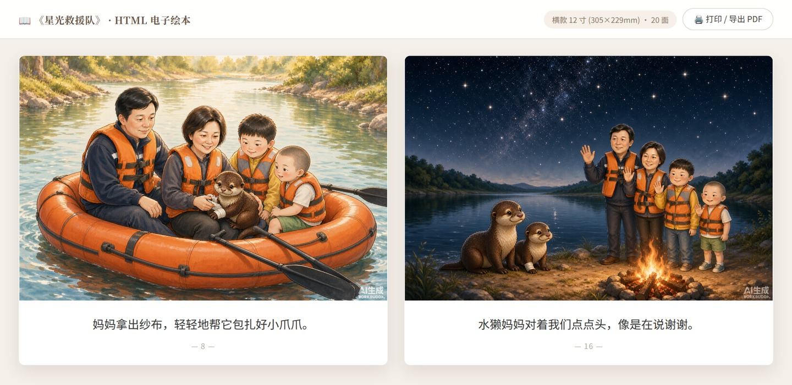

# workbuddy-skill-picture-book

[中文](README.md) | English

**Fairy Tale Picture Book (Photo-Customized) / 童话故事绘本（照片定制）** — A WorkBuddy skill package (compatible with Agent Skill conventions) for creating personalized fairy tale picture books from uploaded photos.

Turn an uploaded portrait or group photo into the protagonist(s) of an original fairy tale, craft a complete page-by-page script, generate style-consistent illustrations across every spread, and deliver both an **interactive HTML e-book** and a **print-ready PDF**.

---

## Key Features

- **Photo-Personalized Protagonist(s) (Single & Multi-Character)**
  - Supports single-protagonist stories as well as multi-character scenes featuring **2 or more human characters** (families, parent-child, siblings, friends).
  - Cartoonizes uploaded photos into a unified illustration style while preserving recognizable facial features, hairstyles, and signature details.
- **End-to-End Cross-Page Consistency System**
  - **Story Bible First**: Locks character appearances, visual anchors, scene lists (with baked-in time-of-day and lighting), prop-holding timelines, and state continuity before scripting any page.
  - **Multi-Tier Reference Image Reuse**: Reuses single-character reference sheets, synthesized all-character group reference sheets, and dedicated reference sheets for 4 high-drift element types (core props/vehicles, animal/fantasy sidekicks, fixed centerpiece objects, and recurring plot props) via `image-to-image`.
  - **Positive Whitelist Prompting**: Names every character with individual positions and actions in group scenes, explicitly declares always-worn gear, and isolates progressive states across similar characters to avoid missing characters, look-alike faces, or prop drift.
  - **Generate-and-Verify Loop**: Inspects illustrations immediately during generation for character, prop, action, and lighting consistency, and validates file existence, page count, and page-to-image mapping before layout.
- **Flexible Formats & Illustration Styles**
  - **4 Illustration Styles**: Soft Watercolor (default), Bright Cartoon, Realistic Illustration, and Beautiful Storybook.
  - **4 Print Sizes**: Square 8" (default), Square 10", Landscape 12", and Portrait 12".
  - **21 Standard Page Counts**: Supports 8–72 pages/sides (default 12 pages).
- **Dual Deliverable Formats**
  - **HTML E-Book**: Responsive browser-ready storybook template with built-in print/PDF export support.
  - **Print-Ready PDF**: Assembled directly from page images using pure Python + Pillow (`scripts/build_pdf.py`) — no headless browser required, reliable across platforms, and compact in file size.

---

## Showcase

Examples below are generated from a real 20-page family storybook (*Starlight Rescue Team*, Landscape 12", multi-character family cast) — all visuals are AI-painted illustrations:

### HTML E-Book Layout Preview



### Reference Sheet Reuse & Cross-Page Consistency


---

## Repository Structure

```text
workbuddy-skill-picture-book/
├── SKILL.md                           # Core skill entry (WorkBuddy spec, v2.2.0): 4-step workflow & CLI triggers
├── assets/
│   └── picture_book_template.html     # Interactive HTML e-book template (single-page flip, double spread, scroll & print)
├── docs/
│   └── images/                        # Showcase images for README
│       ├── demo_html_preview.jpg
│       └── demo_consistency.jpg
├── references/
│   ├── story_prompts.md               # Story Bible template, script template, book.json schema, style prefixes & specs
│   ├── consistency_rules.md           # Cross-page consistency & anti-drift rules (whitelist, multi-char, 4 ref types)
│   └── qa_checklist.md                # During-generation & pre-layout QA checklists
├── scripts/
│   ├── build_book.py                  # One-command book.json validator + HTML & printable PDF builder
│   └── build_pdf.py                   # Pillow-based full-text printable PDF builder (backwards-compatible dir mode)
├── LICENSE                            # Apache License 2.0
├── README.md                          # Chinese README
└── README.en.md                       # English README
```

---

## Book Specifications

### 1. Illustration Styles

| Style | Characteristics |
|-------|----------------|
| **Soft Watercolor** *(default)* | Gentle pastel palette, hand-painted texture, dreamy and warm classic storybook feel |
| **Bright Cartoon** | Clean bold outlines, vibrant saturated colors, cute rounded shapes for younger kids |
| **Realistic Illustration** | Soft natural lighting, rich textures, higher portrait likeness fidelity |
| **Beautiful Storybook** | Delicate painterly strokes, soft dreamy lighting, warm emotional mood |

### 2. Print Sizes & Recommended Aspect Ratios

| Size Name | `size` Arg | Print Dimensions | Recommended Generation Aspect Ratio |
|-----------|------------|------------------|-------------------------------------|
| **Square 8"** *(default)* | `square8` | ~203mm × 203mm | `1:1` |
| **Square 10"** | `square10` | ~254mm × 254mm | `1:1` |
| **Landscape 12"** | `landscape12` | ~305mm × 229mm | `4:3` or `3:2` |
| **Portrait 12"** | `portrait12` | ~229mm × 305mm | `3:4` or `2:3` |

### 3. Page Counts (Sides)

- **Supported values**: `8 / 10 / 12 / 14 / 16 / 18 / 20 / 22 / 24 / 28 / 32 / 36 / 40 / 44 / 48 / 52 / 56 / 60 / 64 / 68 / 72` pages (default **12**).
- **Page breakdown**: Total pages = Front Cover (`1`) + Story Body (`Total - 2`) + Back Cover (`1`).
- **File naming**: `page_01_cover.png` for the front cover, followed by `page_02.png`, `page_03.png`, ... for body pages (the back cover can use the warm gradient template or a dedicated image).

---

## Workflow

The skill follows a strict four-step closed loop:

1. **Photo Pre-Check & Creative Requirements**
   - Evaluate uploaded photos for clarity, angle, and headcount (1–4 characters work best) before confirming **illustration style, book size, page count, and story theme/source** (favoring high-tolerance styles and single-day themes by default).
2. **Write the Story Bible & Page-by-Page Script (Checkpoint 1)**
   - Build the Story Bible (character anchors, relative height lock, scene list, prop/state timeline) and paginated script with mandatory **caption-noun checklists & gaze/interaction directions**, then **wait for explicit user confirmation before generating images**.
3. **Approve Reference Sheets + 2 Sample Pages, Then Batch Generate (Checkpoint 2)**
   - Generate standing full-body character reference sheets, element reference sheets, and **cover + 1 representative body page** for user sign-off on likeness, proportions, and natural posing before batch-generating the remaining pages with 5-question fact-answer QA every 1–3 pages.
4. **Automated Validation, Dual Export & Single-Page Revisions**
   - Write `book.json`, validate with `scripts/build_book.py --check-only`, and export both the interactive HTML e-book and full-text printable PDF (with optional `--crop-watermark` & `--bleed`). Supports targeted single-page redraws and one-command repackaging.

---

## Installation & Usage

### Use as a WorkBuddy Skill

1. **Clone or download this repository into your WorkBuddy skills directory**:
   ```bash
   git clone https://github.com/stevenzyk/workbuddy-skill-picture-book.git ~/.workbuddy/skills/fairy-tale-picture-book
   ```
   > Alternatively, package the skill files as a `.zip` archive (with top-level folder `fairy-tale-picture-book/`) and upload it via WorkBuddy desktop or the WorkBuddy Open Platform.

2. **Trigger in conversation**:
   Upload a clear, well-lit front-facing portrait or family photo and describe your book request, for example:
   - *"Turn this photo of my child into an 8-inch square, 12-page forest adventure fairy tale picture book in soft watercolor style."*
   - *"Create a printable 20-page landscape 12-inch family fairy tale picture book based on this family photo."*

### Run the Builder & PDF Scripts Standalone

**Prerequisite**:
```bash
pip install Pillow
```

**Recommended: Validate and build HTML + full-text printable PDF from `book.json`**:
```bash
# 1. Validate page count & disk images only
python scripts/build_book.py --book ./book/book.json --check-only

# 2. Generate interactive HTML e-book + full-text printable PDF (optional --crop-watermark & --bleed 3)
python scripts/build_book.py --book ./book/book.json --out-dir ./book --dpi 150 --crop-watermark --bleed 3
```

**Legacy Mode: Stitch an image directory directly into a PDF (automatically excludes `ref_*` sheets)**:
```bash
# Square 8" (203mm × 203mm, 150dpi)
python scripts/build_pdf.py ./book ./book_8inch.pdf --size square8

# Landscape 12" (305mm × 229mm, 150dpi) with watermark crop & auto warm-gradient back cover
python scripts/build_pdf.py ./book ./book_12inch.pdf 305 229 150 --crop-watermark --blank-back
```

---

## Maintenance Guidelines

When iterating on or extending this skill, follow the **"Separate Rules from Story Content"** and **Progressive Disclosure** principles:

- **`SKILL.md`**: Keep lean with the 4-step workflow, core cross-model guardrails, and CLI commands to avoid context bloat.
- **`references/consistency_rules.md`**: Maintain reusable cross-page consistency rules using placeholders (`<prop>`, `<character>`).
- **`references/story_prompts.md` & `references/qa_checklist.md`**: Maintain templates, prompt examples, and fact-answer QA checklists.

---

## Privacy & License

- **Privacy & Portraits**: User-uploaded personal photos must be used strictly for creating the requested picture book and never shared externally.
- **Author**: Steven的能量场 (Skill `v2.2.0`)
- **License**: Licensed under the [Apache License 2.0](LICENSE).
