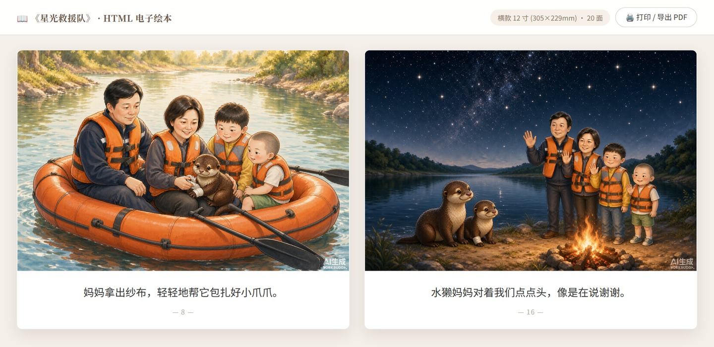
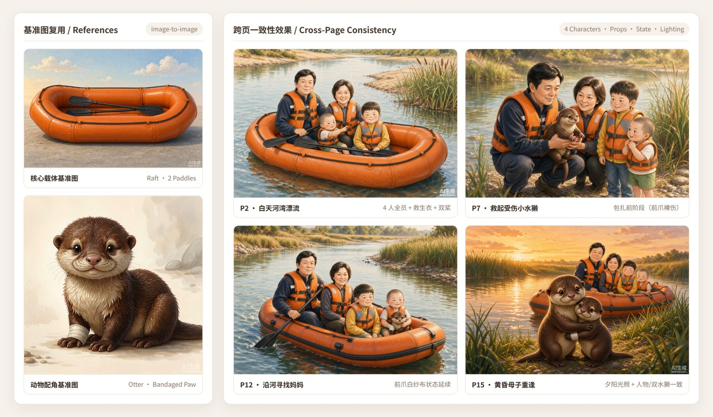

# workbuddy-skill-picture-book

中文 | [English](README.en.md)

**童话故事绘本（照片定制） / Fairy Tale Picture Book** —— 一个面向 WorkBuddy（兼容 Agent Skill 规范）的定制绘本创作技能包。

将用户上传的一张人物照片转化为童话绘本主角，创作完整故事脚本与分镜，生成风格统一、跨页高度一致的绘本插画，并最终输出**可在线翻页浏览的 HTML 电子绘本**与**可直接打印装订的 PDF 绘本文件**。

---

## 核心特性

- **照片定制主角（单人 & 多人同框）**
  - 支持单人主角，也支持全家福、亲子、兄弟姐妹、朋友等 **2 人及以上多角色同框**故事。
  - 将人物照片卡通化为与整本书画风统一的角色形象，同时保留可辨识的面部、发型与标志性特征。
- **全流程防漂移一致性体系**
  - **故事圣经（Story Bible）前置驱动**：先固定人物设定、视觉锚点、场景清单（含昼夜光线）、道具持有时间线与状态连续性，再编写分页脚本。
  - **多级基准图逐页复用**：支持单人基准图、多角色「全员基准图（全家福）」以及四类高漂移元素（核心道具/载体、动物/幻想生物配角、核心固定物体、贯穿性剧情道具）的独立基准图参考（`image-to-image`）。
  - **「正面写全」白名单提示词原则**：多人同框逐个点名位置与动作、恒穿装备显式声明、阶段状态跨角色隔离，减少模型自由发挥导致的漏人、撞脸、穿帮或道具变形。
  - **边生成边核验闭环**：每生成一批插画即核对人物/道具/动作/光照，排版前强校验图片数量、文件名映射与图文一一对应。
- **多种规格与画风可选**
  - **4 种插画风格**：温馨水彩风（默认）、明亮卡通风、写实插画风、唯美绘本风。
  - **4 种印刷尺寸**：方款 8 寸（默认）、方款 10 寸、横款 12 寸、竖款 12 寸。
  - **丰富页数档位**：支持 8–72 面共 21 种标准印刷面数（默认 12 面）。
- **双格式成品交付**
  - **HTML 电子绘本**：基于响应式网页模板，支持屏幕阅读与浏览器打印导出。
  - **打印级 PDF**：通过纯 Python + Pillow 的 `scripts/build_pdf.py` 直接拼合页面图片，不依赖 headless 浏览器，输出稳定、体积轻巧。

---

## 效果展示

以下示例均来自真实生成案例《星光救援队》（横款 12 寸 · 20 面 · 一家四口多人同框），均为 AI 绘制插画效果：

### HTML 电子绘本排版效果



### 多级基准图复用与跨页一致性



---

## 目录结构

```text
workbuddy-skill-picture-book/
├── SKILL.md                           # 技能核心规范：工作流、故事圣经、一致性规则与自检闭环（v1.0.0）
├── assets/
│   └── picture_book_template.html     # 可浏览与打印的 HTML 电子绘本模板（含 @media print 与 @page 样式）
├── docs/
│   └── images/                        # README 效果展示图片
│       ├── demo_html_preview.jpg
│       └── demo_consistency.jpg
├── references/
│   └── story_prompts.md               # 故事圣经模板、分页脚本模板、风格提示词、核验清单与规格对照表
├── scripts/
│   └── build_pdf.py                   # 基于 Pillow 的打印级 PDF 合成脚本
├── LICENSE                            # Apache License 2.0 开源协议
├── README.md                          # 中文说明文档
└── README.en.md                       # 英文说明文档
```

---

## 绘本规格对照

### 1. 插画风格

| 风格名称 | 适用场景与特点 |
|---------|----------------|
| **温馨水彩风**（默认） | 柔和粉彩色调、手绘质感、梦幻温暖的经典童话氛围 |
| **明亮卡通风** | 线条干净利落、色彩饱满明快、圆润可爱，适合低龄儿童 |
| **写实插画风** | 自然柔和光影、丰富纹理细节、人物外貌还原度更高 |
| **唯美绘本风** | 柔美光影与细腻笔触、情感氛围柔和治愈 |

### 2. 绘本尺寸

| 尺寸名称 | 实际印刷尺寸 | HTML `@page` / PDF 参数 |
|---------|-------------|--------------------------|
| **方款 8 寸**（默认） | 约 203mm × 203mm | `203 203` |
| **方款 10 寸** | 约 254mm × 254mm | `254 254` |
| **横款 12 寸** | 约 305mm × 229mm | `305 229` |
| **竖款 12 寸** | 约 229mm × 305mm | `229 305` |

### 3. 页数（面数）

- **可选值**：`8 / 10 / 12 / 14 / 16 / 18 / 20 / 22 / 24 / 28 / 32 / 36 / 40 / 44 / 48 / 52 / 56 / 60 / 64 / 68 / 72` 面（默认 **12 面**）。
- **页数计算**：总面数 = 封面（1 面）+ 正文（`总面数 - 2` 面）+ 封底（1 面）。
- **文件命名**：封面为 `page_01_cover.png`，正文依次为 `page_02.png`、`page_03.png` ……（封底可使用纯色/文案模板页或独立插画）。

---

## 工作流程

本技能严格按照以下四步闭环执行：

1. **确认创作需求**
   - 收集并确认 **插画风格、绘本尺寸、页数（面数）、故事主题/来源**（支持 AI 原创或基于用户大纲扩展），并接收用户上传的人物照片。
2. **编写「故事圣经」与分页脚本**
   - 分析照片提取人物外貌锚点，完成故事圣经（人物设定、视觉锚点、场景清单、道具时间线、状态连续性）。
   - 生成逐页脚本（每页含场景锚点、英文画面描述、道具持有状态、1–3 句中文文案 30–60 字、状态变化），**必须展示给用户确认满意后才开始生图**。
3. **生成基准图与各页插画**
   - 先生成主角卡通化基准图（多人类角色时先合成全员基准图），以及核心道具/载体、动物配角、固定物体、贯穿道具的干净特写基准图。
   - 按「风格前缀 + 人物锚点 + 道具/配角锚点 + 场景锚点 + 画面动作描述」逐页复用视觉锚点与参考图生图，**边生成边通过视觉检查拦截漏人、错位与风格漂移**。
4. **排版与导出交付**
   - 核对所有图片数量、页码映射与磁盘文件完整性后，组装 `HTML` 电子绘本（封面标题置于顶部留白区避免遮挡人物）。
   - 调用 `scripts/build_pdf.py` 生成指定印刷尺寸的 `PDF` 文件交付打印。

---

## 安装与使用

### 作为 WorkBuddy Skill 使用

1. **克隆或下载本仓库到 WorkBuddy 技能目录**：
   ```bash
   git clone https://github.com/stevenzyk/workbuddy-skill-picture-book.git ~/.workbuddy/skills/fairy-tale-picture-book
   ```
   > 也可以将仓库目录打包为 `.zip`（或使用已打包的 `fairy-tale-picture-book.zip`），在 WorkBuddy 客户端「技能 > 添加技能 > 上传」中直接导入。

2. **在对话中触发**：
   上传一张清晰正面的人物照片，并说明需求，例如：
   - 「把这张宝宝照片做成一本方款 8 寸、12 面的森林冒险童话绘本，温馨水彩风。」
   - 「用这张全家福定制一本可以打印的亲子绘本。」

### 单独运行 PDF 合成脚本

`scripts/build_pdf.py` 用于将绘本页面图片（按文件名排序）等比缩放居中铺入白底 PDF，默认 150 dpi（20 页约 7 MB），避免依赖 Playwright/Chromium headless 导出在部分环境下静默失败或文件过大的问题。

**前置依赖**：
```bash
pip install Pillow
```

**命令行用法**：
```bash
python scripts/build_pdf.py <图片目录> <输出pdf路径> [页面宽mm] [页面高mm] [dpi]
```

**常用示例**：
```bash
# 方款 8 寸 (203mm × 203mm, 150dpi)
python scripts/build_pdf.py ./book ./book_8inch.pdf 203 203

# 横款 12 寸 (305mm × 229mm, 150dpi)
python scripts/build_pdf.py ./book ./book_12inch_landscape.pdf 305 229

# 更高打印清晰度 (200dpi)
python scripts/build_pdf.py ./book ./book_hq.pdf 254 254 200
```

> 说明：脚本会自动收集目录下的 `*.png`、`*.jpg`、`*.jpeg` 并按文件名排序；如未提供宽高参数，默认尺寸为 `200mm × 200mm`、`dpi=150`。使用 HTML 模板（`assets/picture_book_template.html`）打印时，也请同步修改 `@page { size: ... }` 为对应尺寸。

---

## 维护与二次开发规范

若需对本技能规则进行迭代优化，请遵循 `SKILL.md` 中规定的**「规则与故事分离」**原则：

- **规则回答「怎么做」，示例回答「某个具体故事的 X 是什么」**。
- **`SKILL.md`**：只存放可迁移的通用规则（使用 `<道具>`、`<角色>` 等占位符与原则句），避免把某个具体故事的设定写死成全局规则。
- **`references/story_prompts.md`**：存放完整的故事圣经模板、提示词示范与逐条核验清单。

---

## 隐私与协议

- **肖像与隐私**：用户上传的人物照片仅用于当前绘本创作流程，严禁擅自外传或挪作他用。
- **作者**：Steven的能量场（Skill 版本 `v1.0.0`）
- **开源协议**：本项目基于 [Apache License 2.0](LICENSE) 开源。
